<!--
  Profile README for adityakumarsingh1682006-debug
  Layout: HTML + Markdown only (GitHub-compatible, no JavaScript).
  All local images live in /assets. Stats cards come from public GitHub stats services
  and use your live GitHub data.
-->

<!-- 1. WELCOME BANNER -->

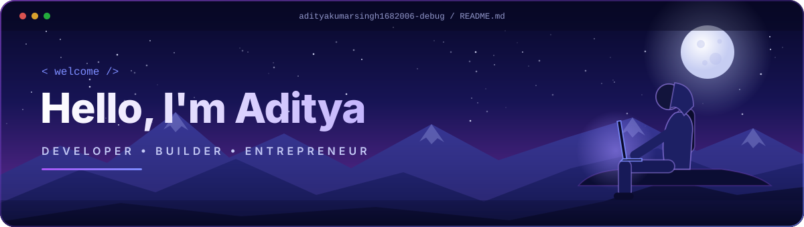

<!-- 2. SOCIAL MEDIA LINKS -->

<!--
  Add your other links here once you are ready (replace the placeholders, then remove the comment markers):

  
  
-->

 

<!-- 3. ABOUT ME -->

  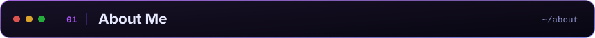

<table>
  <tr>
    <td align="center" valign="top" width="38%">
      
    </td>
    <td valign="top">
      <h3>Hi, I'm Aditya (Adi)</h3>
      

        A student at the <b>University of Delhi</b> interested in technology, entrepreneurship,
        and building products that solve real-world problems.
      

      

        I enjoy the space where technology meets business: turning ideas into working products,
        learning new tools along the way, and exploring how startups are built.
      

      

        <code>Developer</code> &nbsp; <code>Builder</code> &nbsp; <code>Entrepreneur</code> &nbsp; <code>Problem Solver</code>
      

      

        <b>Name</b> &nbsp;Aditya Kumar Singh 
        <b>University</b> &nbsp;University of Delhi 
        <b>Interests</b> &nbsp;Technology · Business · Entrepreneurship
      

    </td>
  </tr>
</table>

 

<!-- 4. FEATURED PROJECTS -->

  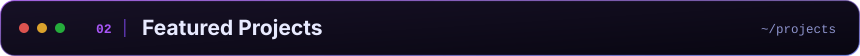

<table>
  <tr>
    <td align="center" valign="top" width="33%">
      <a href="https://medikey-six.vercel.app/">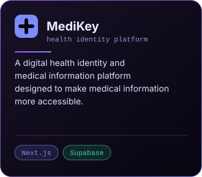</a>
       
      <a href="https://medikey-six.vercel.app/">Live Demo</a> &nbsp;·&nbsp; <a href="https://github.com/cyberpunkadi/medikey">GitHub</a>
    </td>
    <td align="center" valign="top" width="33%">
      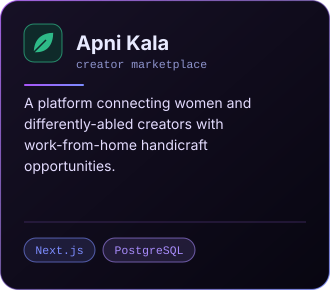
       
      In development
    </td>
    <td align="center" valign="top" width="33%">
      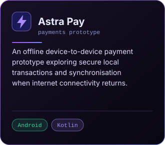
       
      In development
    </td>
  </tr>
</table>

 

<!-- 5. TECHNOLOGIES & TOOLS -->

  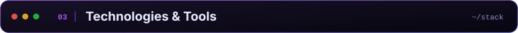

Technologies and tools I work with or am exploring

 

<!-- 6. GITHUB STATISTICS -->

  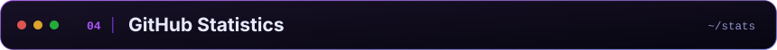

 

<!-- 7. HOBBIES & GOALS -->

  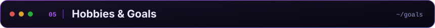
  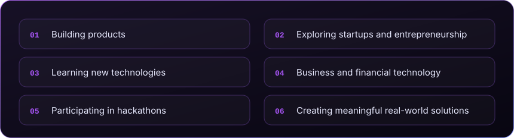

 

<!-- 8. CURRENTLY BUILDING -->

  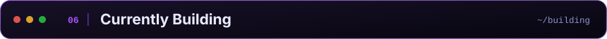
  

 

<!-- 9. CURRENTLY EXPLORING -->

  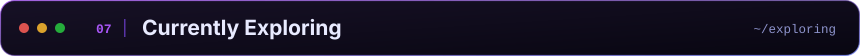
  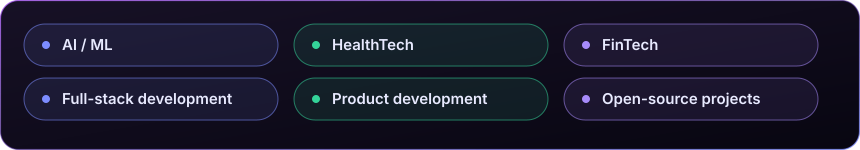

 

<!-- 10. PERSONAL QUOTE & FOOTER -->

  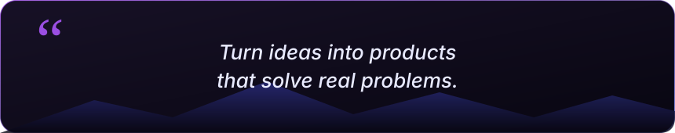
    
  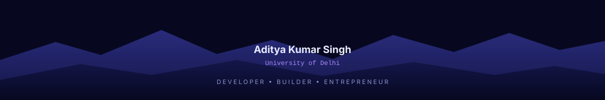

